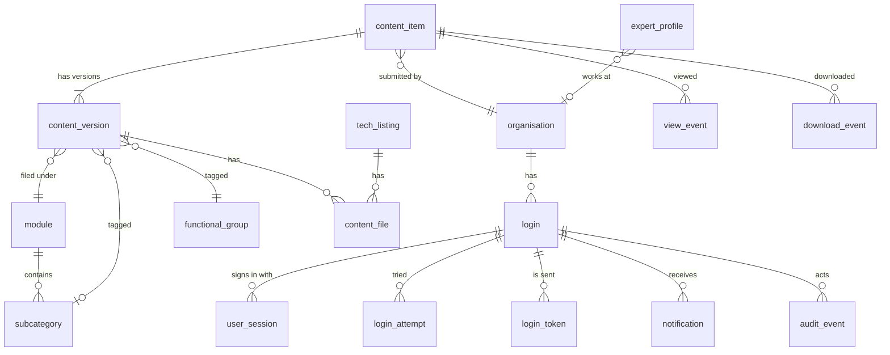

# Data model

The database design every feature task builds its migrations from (`P0-ARC-01`). Each task creates its own tables in its own Alembic migration, following this design. If a task needs a change, change this document in the same pull request.

It covers the entities in SRS 6.1, the fields in Appendices A to C, and the tables in the [architecture data model overview](architecture.md#data-model-overview). It is based on the proposed decisions D-01 to D-14 in [decisions.md](decisions.md), which ITPED has not yet confirmed (`P0-GOV-01`).

## Conventions

- **Keys.** A table whose rows appear in a URL has a `uuid` primary key, generated in Python with `uuid.uuid4()`, so IDs cannot be guessed or counted. Log tables use `bigint generated always as identity`. The fixed `module` table uses `smallint`.
- **Enumerations** are `text` columns with a `CHECK (col IN (...))` constraint, not PostgreSQL enum types, so adding a value is a one-line migration. Values are lowercase `snake_case`.
- **Timestamps** are `timestamptz`, stored in UTC and shown in IST (`app.core.time`). Columns end in `_at`. Dates without a time, such as `next_review_date`, are `date`.
- **Text limits.** Every free-text column has a length limit, enforced by its Pydantic schema and by a `CHECK (char_length(col) <= n)` constraint. The tables give the limit as `text(n)`.
- **Who did it.** Columns ending in `_by` are foreign keys to `login.id`.
- **Foreign keys** use the default `ON DELETE NO ACTION`. Nothing uses `ON DELETE CASCADE`: content, expert, Gallery and audit rows are never hard-deleted (SRS 6.3), so a parent can never be removed from under them.
- **No deletion.** Records leave view through a state or a flag, such as `status`, `discarded_at` or `retired`. The only exceptions are listed under [Deletion](#deletion).
- **Indexes.** Every foreign key column has an index unless it leads another index. Partial and unique indexes are listed with each table.
- **Names.** Tables are singular. Constraint names follow SQLAlchemy's naming convention in `app.core.db`.

**Admin-only** in the tables marks a column that Appendix A, B or C says only Admin, Reviewer and Approver may see. These columns must never appear in a Member or public view schema (`P2-CON-02`, FR-3.3, FR-3.7). They are collected in [Admin-only columns](#admin-only-columns).

## Overview

`workflow_event`, `audit_event` and `notification` point at their subject with a `subject_type` (or `target_type`) and an ID, not a foreign key, because one table serves several subject tables.

## Accounts

### `organisation`

A recognised Discom (SRS 6.1, FR-1.6). Created in `P1-ACC-01`.

| Column | Type | Null | Default | Notes |
| --- | --- | --- | --- | --- |
| `id` | uuid | No | | Primary key |
| `name` | text(200) | No | | Unique |
| `email_domain` | text(253) | No | | Unique. Lowercase, `CHECK (email_domain = lower(email_domain))`. Registration email must match (D-11) |
| `status` | text | No | `'active'` | `active` or `inactive`. An inactive Discom cannot register or sign in |
| `extra_email` | text(254) | Yes | | Phase 5 second notification address, same domain (`P5-NOT-03`) |
| `extra_email_verified_at` | timestamptz | Yes | | Set when the confirmation link is used |
| `created_at` | timestamptz | No | `now()` | |
| `updated_at` | timestamptz | No | `now()` | |

The link to its Member login is `login.organisation_id`. Registration and verification timestamps (SRS 6.1) are on that login: `created_at` and `verified_at`.

### `login`

Every person or shared Discom account that can sign in. Exactly four login types (FR-2.1). Created in `P1-ACC-08`; lockout fields in `P1-ACC-04`, MFA fields in `P1-ACC-10`, verification fields in `P1-ACC-03`.

| Column | Type | Null | Default | Notes |
| --- | --- | --- | --- | --- |
| `id` | uuid | No | | Primary key |
| `user_id` | text(50) | No | | Unique. Stored lowercase, `CHECK (user_id ~ '^[a-z0-9._-]{4,50}$')`, so uniqueness is case-insensitive |
| `email` | text(254) | No | | |
| `password_hash` | text | Yes | | argon2id. Null until a new privileged account sets its password |
| `login_type` | text | No | | `member`, `admin`, `reviewer` or `approver` |
| `organisation_id` | uuid | Yes | | FK `organisation`, added by `P1-ACC-01` with that table. `CHECK (login_type <> 'member' OR organisation_id IS NOT NULL)`. Optional for a Reviewer from a Discom (FR-2.9) |
| `full_name` | text(200) | Yes | | `CHECK (login_type = 'member' OR full_name IS NOT NULL)`: privileged accounts are named people (FR-2.7) |
| `is_alternate` | boolean | No | `false` | `CHECK (NOT is_alternate OR login_type = 'reviewer')` |
| `status` | text | No | `'pending'` | `pending`, `active`, `declined` or `deactivated` |
| `verified_at` | timestamptz | Yes | | When Admin approved or declined a Member registration |
| `verified_by` | uuid | Yes | | FK `login` |
| `decline_reason` | text(1000) | Yes | | Required when `status = 'declined'` |
| `failed_count` | integer | No | `0` | Consecutive failed sign-ins (FR-1.7) |
| `locked_until` | timestamptz | Yes | | |
| `mfa_method` | text | Yes | | `totp` or `email`. Null means MFA is off, which only a Member may keep: a privileged login with none enrols at its next sign-in (FR-2.8). `CHECK (mfa_method IS DISTINCT FROM 'totp' OR mfa_totp_secret IS NOT NULL)` |
| `mfa_totp_secret` | text | Yes | | Fernet-encrypted with a key from the environment. Never logged. Set with no `mfa_method` while an authenticator enrolment waits for its first code |
| `mfa_totp_last_step` | bigint | Yes | | The last authenticator time step accepted, so a code cannot be used twice (added in `P1-ACC-10`) |
| `mfa_enrolled_at` | timestamptz | Yes | | |
| `created_at` | timestamptz | No | `now()` | For a Member, the registration request time |
| `updated_at` | timestamptz | No | `now()` | |

Indexes:

- `UNIQUE (organisation_id) WHERE login_type = 'member' AND status IN ('pending', 'active')`: one pending or active Member login per Discom (FR-1.6, FR-2.2). A declined or deactivated login frees the Discom to register again.
- `UNIQUE (lower(email)) WHERE status IN ('pending', 'active')`: each current login has its own email, so no privileged account is shared (FR-2.7, added in `P1-ACC-09`), and password reset can find the login by email (`P1-ACC-05`).
- `(login_type, status)`, for the Admin account lists and queue defaults.

The rules "one active Approver" and "one active primary and one active alternate Reviewer" (`P1-ACC-09`) are enforced by the database too:

- `UNIQUE (login_type) WHERE login_type = 'approver' AND status = 'active'`
- `EXCLUDE USING btree (is_alternate WITH =) WHERE login_type = 'reviewer' AND status = 'active'`, `DEFERRABLE INITIALLY DEFERRED`. An exclusion constraint rather than a unique index, because only a constraint can be deferred, and swapping the primary and alternate Reviewer passes through a moment with two of one kind.

### `user_session`

One signed-in browser. The cookie holds the token, the table holds only its SHA-256 hash. Created in `P1-ACC-06`.

| Column | Type | Null | Default | Notes |
| --- | --- | --- | --- | --- |
| `id` | uuid | No | | Primary key. In the Member "Signed-in devices" page (`P1-ACC-07`) |
| `token_hash` | bytea | No | | Unique. SHA-256 of the cookie token |
| `login_id` | uuid | No | | FK `login` |
| `csrf_token` | text(64) | No | | |
| `mfa_pending` | boolean | No | `false` | True between password and second factor (`P1-ACC-10`) |
| `created_at` | timestamptz | No | `now()` | |
| `last_seen_at` | timestamptz | No | `now()` | Updated at most once a minute |
| `ended_at` | timestamptz | Yes | | Null while active |
| `end_reason` | text | Yes | | `logout`, `idle`, `replaced`, `admin`, `password_reset` or `locked` (too many wrong codes, `P1-ACC-10`). `CHECK ((ended_at IS NULL) = (end_reason IS NULL))` |
| `ip` | inet | No | | |
| `user_agent` | text(500) | No | `''` | |

Indexes: `(login_id) WHERE ended_at IS NULL`, for the 5-device count (FR-2.3).

Ended sessions are kept, because audit events refer to them by `session_id` (SRS 2.3).

### `login_attempt`

Every sign-in attempt, including unknown User IDs (FR-1.7). Created in `P1-ACC-04`.

| Column | Type | Null | Default | Notes |
| --- | --- | --- | --- | --- |
| `id` | bigint identity | No | | Primary key |
| `attempted_user_id` | text(254) | No | | As typed, truncated. Never the password |
| `login_id` | uuid | Yes | | FK `login`. Null for an unknown User ID |
| `ip` | inet | No | | |
| `user_agent` | text(500) | No | `''` | |
| `success` | boolean | No | | |
| `reason` | text | No | | `ok`, `unknown_user`, `bad_password`, `locked`, `inactive` or `mfa_failed` |
| `at` | timestamptz | No | `now()` | |

Indexes: `(login_id, at)`, `(ip, at)` for lockout alerts.

### `login_token`

Single-use secrets sent by email: set-password and reset links, email MFA codes and the extra-address confirmation. One table, so expiry, hashing and single use are written once. Created in `P1-ACC-09` (the first task that needs it, for set-password links), and reused by `P1-ACC-05`, `P1-ACC-10` and `P5-NOT-03` through `app.accounts.tokens`.

| Column | Type | Null | Default | Notes |
| --- | --- | --- | --- | --- |
| `id` | bigint identity | No | | Primary key |
| `login_id` | uuid | No | | FK `login` |
| `purpose` | text | No | | `set_password`, `reset_password`, `mfa_email_code` or `confirm_extra_email` |
| `token_hash` | bytea | No | | Unique. SHA-256 of the link token or code |
| `attempts` | smallint | No | `0` | Wrong tries, for email codes (5 at most, `P1-ACC-10`) |
| `expires_at` | timestamptz | No | | 60 minutes for links, 10 for codes |
| `used_at` | timestamptz | Yes | | Set once. A used or expired token is refused |
| `created_at` | timestamptz | No | `now()` | |

Indexes: `(login_id, purpose) WHERE used_at IS NULL`.

## Audit and settings

### `app_setting`

Admin-editable settings (see [architecture.md](architecture.md#settings)). Created in `P0-SET-02`.

| Column | Type | Null | Default | Notes |
| --- | --- | --- | --- | --- |
| `key` | varchar(64) | No | | Primary key. Must be a key in `SETTING_RULES` |
| `value` | jsonb | No | | |
| `updated_by` | uuid | Yes | | FK `login`, added by `P1-ACC-08` with the `login` table. Changed from integer to `uuid` in `P1-AUD-01` |
| `updated_at` | timestamptz | No | | |

The configurable AIDA Endorsed criteria and disclaimer (`P5-END-01`) and the Gallery entry conditions (`P5-GAL-01`) are settings too, stored as JSON values, with no tables of their own.

### `audit_event`

The append-only audit trail (FR-12.1, SRS 2.3). Created in `P1-AUD-01`.

| Column | Type | Null | Default | Notes |
| --- | --- | --- | --- | --- |
| `id` | bigint identity | No | | Primary key |
| `occurred_at` | timestamptz | No | `now()` | |
| `actor_login_id` | uuid | Yes | | FK `login`, added by `P1-ACC-08`. Null for anonymous and system actions |
| `actor_kind` | text | No | | `member`, `admin`, `reviewer`, `approver`, `anonymous` or `system` |
| `session_id` | uuid | Yes | | The `user_session.id`. No foreign key, so the audit insert never depends on session state |
| `ip` | inet | Yes | | Raw IP, kept for incident reporting (CERT-In) |
| `user_agent` | text(500) | Yes | | |
| `action` | text(64) | No | | `module.verb`, such as `accounts.login` |
| `target_type` | text(32) | Yes | | Such as `content`, `login`, `setting` |
| `target_id` | text(64) | Yes | | A UUID, or a setting key |
| `result` | text | No | | `success`, `failure` or `denied` |
| `details` | jsonb | No | `'{}'` | Never passwords, tokens, codes or secrets. For experts, only the profile ID (`P3-EXP-01`) |

Indexes: `(occurred_at)`, `(target_type, target_id)`, `(actor_login_id, occurred_at)`.

A trigger raises an error on any UPDATE or DELETE. Rows are kept at least 3 years; the newest 180 days are searchable online (FR-12.1). Older rows move to archive storage by an operations job, outside the application role.

## Taxonomy

Created in `P2-CON-01`, seeded with the baseline in [decisions.md](decisions.md#taxonomy-baseline-srs-appendix-a).

### `module`

The six fixed home-screen modules. Seeded, with no edit screen.

| Column | Type | Null | Default | Notes |
| --- | --- | --- | --- | --- |
| `id` | smallint | No | | Primary key, set by the seed |
| `slug` | text(50) | No | | Unique. Used in URLs |
| `name` | text(100) | No | | |
| `kind` | text | No | | `documents`, `experts` or `gallery` |
| `display_order` | smallint | No | | |

### `subcategory`

| Column | Type | Null | Default | Notes |
| --- | --- | --- | --- | --- |
| `id` | uuid | No | | Primary key |
| `module_id` | smallint | No | | FK `module`. Only `documents` modules have subcategories |
| `name` | text(100) | No | | |
| `slug` | text(100) | No | | |
| `status` | text | No | `'active'` | `active` or `retired`. Retired values are hidden from new submissions |
| `display_order` | smallint | No | | |

Unique: `(module_id, slug)`, `(module_id, name)`.

### `functional_group`

Admin-only tag (Appendix A).

| Column | Type | Null | Default | Notes |
| --- | --- | --- | --- | --- |
| `id` | uuid | No | | Primary key |
| `name` | text(100) | No | | Unique |
| `status` | text | No | `'active'` | `active` or `retired` |
| `display_order` | smallint | No | | |

## Content

### Version design (D-09)

A content item has two parts:

- `content_item` holds what does not change between versions: identity, workflow state, assignments, endorsement, counters and lifecycle flags.
- `content_version` holds the fields a person edits: title, tags, tier, summary and the rights declaration. Files belong to a version.

`content_item.published_version_id` points at the version the public and Members see. `content_item.working_version_id` points at a version being prepared or reviewed.

| Situation | `state` | `published_version_id` | `working_version_id` | `working_state` |
| --- | --- | --- | --- | --- |
| New Draft, up to approval | `draft` to `pending_approval` | Null | The first version | Null |
| Published, no edit open | `published` | The live version | Null | Null |
| Substantive edit open (FR-4.9) | `published` | The live version, still shown | The new version | `under_review` or `pending_approval` |

- Before first publication, `state` is the workflow state of the item and its one version.
- A **minor edit** updates the published version in place, with old and new values in the audit event.
- A **substantive edit** copies the published version into a new version and sets `working_version_id` and `working_state = 'under_review'`. On approval, `published_version_id` takes the working version's ID, and the working columns are cleared, in one transaction. On rejection, the working version gets `discarded_at` and the working columns are cleared. Old versions are kept.
- `CHECK ((working_state IS NULL) OR (working_version_id IS NOT NULL AND state = 'published'))`. Only one working version can exist at a time, so a second substantive edit is refused (`P2-WF-06`).

### `content_item`

Created in `P2-CON-02`, with later columns from the tasks named.

| Column | Type | Null | Default | Notes |
| --- | --- | --- | --- | --- |
| `id` | uuid | No | | Primary key. In item URLs |
| `item_type` | text | No | | `file` or `external_link` (FR-3.8) |
| `state` | text | No | `'draft'` | `draft`, `submitted`, `under_review`, `pending_approval`, `returned`, `rejected`, `approved` or `published` ([workflow.md](workflow.md)) |
| `working_state` | text | Yes | | `under_review` or `pending_approval`, for a substantive edit |
| `returned_to` | text | Yes | | `submitter` or `admin`, set when returned (FR-4.3) |
| `published_version_id` | uuid | Yes | | FK `content_version` |
| `working_version_id` | uuid | Yes | | FK `content_version` |
| `submitting_organisation_id` | uuid | Yes | | FK `organisation`. Null for ITPED-sourced items |
| `source_organisation` | text(200) | No | | Displayed as Source Organisation. Set at creation and never changed by Admin or Reviewer edits (FR-2.4) |
| `owner_login_id` | uuid | Yes | | FK `login`. **Admin-only** (proposed owner) |
| `reviewer_login_id` | uuid | Yes | | FK `login`. **Admin-only** (proposed or assigned Reviewer) |
| `approver_login_id` | uuid | Yes | | FK `login`. **Admin-only** (approving authority) |
| `recused_reviewer_login_id` | uuid | Yes | | FK `login`. Phase 5 recusal (`P5-ACC-02`). **Admin-only** |
| `next_review_date` | date | Yes | | **Admin-only**. Set at approval, Phase 5 (`P5-WF-01`) |
| `proposed_review_date` | date | Yes | | **Admin-only**. A change waiting for Approver countersignature |
| `proposed_review_reason` | text(1000) | Yes | | **Admin-only** |
| `proposed_review_by` | uuid | Yes | | FK `login`. **Admin-only** |
| `endorsement_candidate` | boolean | No | `false` | **Admin-only**. Reviewer's proposal (`P2-END-01`) |
| `endorsed` | boolean | No | `false` | Displayed as AIDA Endorsed |
| `endorsed_at` | timestamptz | Yes | | |
| `endorsed_by` | uuid | Yes | | FK `login`. Must be the Approver |
| `endorsed_criteria_version` | integer | Yes | | Criteria version at endorsement (`P5-END-01`) |
| `view_count` | integer | No | `0` | Members and visitors only (D-13). Used by Most Viewed |
| `download_count` | integer | No | `0` | Displayed as the citation count, "Downloads" (D-05, FR-6.4) |
| `published_at` | timestamptz | Yes | | Date of posting. Set at first approval |
| `discarded_at` | timestamptz | Yes | | A discarded Draft (SRS 6.3) |
| `retired` | boolean | No | `false` | Phase 5 flag, not a state (D-08, `P5-LIFE-02`) |
| `retired_at` | timestamptz | Yes | | |
| `retired_by` | uuid | Yes | | FK `login` |
| `retired_reason` | text(1000) | Yes | | |
| `link_status` | text | Yes | | External links: `ok` or `broken` (`P5-CON-02`) |
| `link_checked_at` | timestamptz | Yes | | |
| `link_failures` | smallint | No | `0` | Consecutive failed checks |
| `created_by` | uuid | No | | FK `login` |
| `created_at` | timestamptz | No | `now()` | |
| `updated_at` | timestamptz | No | `now()` | |

Checks:

- `CHECK (state <> 'published' OR published_version_id IS NOT NULL)`
- `CHECK (NOT endorsed OR (endorsed_at IS NOT NULL AND endorsed_by IS NOT NULL))`
- `CHECK (NOT retired OR retired_at IS NOT NULL)`
- `CHECK (view_count >= 0 AND download_count >= 0)`

Indexes:

- `(state)`, for the queues.
- `(published_at DESC) WHERE state = 'published' AND NOT retired`, for listings and Newly Added (FR-6.1).
- `(submitting_organisation_id, state)`, for the Member's own submissions.
- `(reviewer_login_id) WHERE state = 'under_review' OR working_state = 'under_review'`.
- `(next_review_date) WHERE state = 'published' AND NOT retired`, for the reassessment queue (`P5-LIFE-01`).

Counters change only with `UPDATE content_item SET view_count = view_count + 1` (`P3-LIST-02`). Only `apply_action()` changes `state` and `working_state` (`P2-WF-01`).

### `content_version`

The editable fields of Appendix A. Created in `P2-CON-02`; `search_vector` in `P3-SRCH-01`.

| Column | Type | Null | Default | Notes |
| --- | --- | --- | --- | --- |
| `id` | uuid | No | | Primary key |
| `item_id` | uuid | No | | FK `content_item` |
| `title` | text(300) | Yes | | Displayed. Required at submission |
| `module_id` | smallint | Yes | | FK `module`. Displayed as Category. Must be a `documents` module |
| `subcategory_id` | uuid | Yes | | FK `subcategory`. Displayed. Must belong to `module_id` |
| `functional_group_id` | uuid | Yes | | FK `functional_group`. **Admin-only** |
| `access_tier` | text | Yes | | `public` or `restricted`. **Admin-only**, never rendered (D-03). Required at submission. A null tier is treated as Restricted (SRS 5.3) |
| `jurisdiction` | text(200) | Yes | | **Admin-only**. Applicable jurisdiction, as text |
| `jurisdiction_organisation_id` | uuid | Yes | | FK `organisation`. **Admin-only**. When the jurisdiction is one Discom |
| `original_source` | text(300) | Yes | | Displayed. Required at submission (FR-3.6) |
| `year_of_publication` | smallint | Yes | | Displayed. `CHECK (year_of_publication BETWEEN 1900 AND 2100)` |
| `summary` | text(600) | Yes | | Displayed. 50 to 600 characters at submission |
| `external_url` | text(2000) | Yes | | Displayed, as the item's link. `CHECK (external_url ~ '^https?://')` (FR-3.8) |
| `rights_declaration` | text | Yes | | `holds_rights` or `public_domain`. **Admin-only**, shown to the Reviewer (FR-3.9) |
| `rights_declared_by` | uuid | Yes | | FK `login`. **Admin-only** |
| `rights_declared_at` | timestamptz | Yes | | **Admin-only** |
| `public_teaser` | text | Yes | | `yes` or `no`. **Admin-only**. Set by the Reviewer for Restricted items (FR-13.4) |
| `search_vector` | tsvector | Yes | | Title A, summary B, source organisation and subcategory C, full text D (Phase 5). Maintained by the service, not a trigger |
| `discarded_at` | timestamptz | Yes | | A rejected working version |
| `created_by` | uuid | No | | FK `login` |
| `created_at` | timestamptz | No | `now()` | |

Fields are nullable so a Draft can be saved half-filled. The submit guard in `apply_action()` checks every required field, including `access_tier`, and no edit may set the tier back to null.

Indexes: `(item_id)`, GIN `(search_vector)`, `(module_id, subcategory_id)`. Phase 5 adds a `pg_trgm` GIN index on `title` for duplicate detection (`P5-SRCH-03`).

Format (Appendix A, displayed) is not stored: it comes from the file's `extension`.

### `content_file`

Every stored file: item files, Gallery evidence and videos, and internal workspace documents. One table, so upload, scanning and delivery are written once. Created in `P2-CON-02`.

| Column | Type | Null | Default | Notes |
| --- | --- | --- | --- | --- |
| `id` | uuid | No | | Primary key. In file URLs |
| `version_id` | uuid | Yes | | FK `content_version` |
| `tech_listing_id` | uuid | Yes | | FK `tech_listing` (Phase 3) |
| `workspace_document_id` | uuid | Yes | | FK `workspace_document` (Phase 5) |
| `purpose` | text | No | `'main'` | `main`, `evidence` or `video` |
| `storage_key` | text(200) | No | | Unique. Generated, never the user's file name |
| `original_filename` | text(255) | No | | Sent only in `Content-Disposition` |
| `extension` | text(10) | No | | Lowercase, from the format table in `app/content/formats.py` |
| `mime_type` | text(100) | No | | Sniffed type |
| `size_bytes` | bigint | No | | `CHECK (size_bytes > 0)` |
| `sha256` | bytea | Yes | | Set after a clean scan |
| `scan_status` | text | No | `'pending'` | `pending`, `clean`, `infected`, `type_mismatch` or `error` |
| `scanned_at` | timestamptz | Yes | | |
| `preview_storage_key` | text(200) | Yes | | PDF preview of an Office file (`P3-VIEW-02`) |
| `width` | integer | Yes | | Images and video |
| `height` | integer | Yes | | Images and video |
| `duration_seconds` | integer | Yes | | Audio and video |
| `created_by` | uuid | No | | FK `login` |
| `created_at` | timestamptz | No | `now()` | |

Checks: exactly one of `version_id`, `tech_listing_id` and `workspace_document_id` is set: `CHECK (num_nonnulls(version_id, tech_listing_id, workspace_document_id) = 1)`.

Indexes: `(version_id)`, `(tech_listing_id)`, `(workspace_document_id)`, `(sha256)` for duplicate detection, `(scan_status) WHERE scan_status = 'pending'`.

Only `clean` files can be opened. Quarantined files are never served (`P2-UPL-03`). A replaced file stays on its old version.

### `workflow_event`

One row per state change, for content, experts and Gallery listings (FR-4.6). Created in `P2-WF-01`.

| Column | Type | Null | Default | Notes |
| --- | --- | --- | --- | --- |
| `id` | bigint identity | No | | Primary key |
| `subject_type` | text | No | | `content`, `expert` or `gallery` |
| `subject_id` | uuid | No | | |
| `version_id` | uuid | Yes | | FK `content_version`, for content events |
| `from_state` | text | No | | |
| `to_state` | text | No | | |
| `action` | text(32) | No | | Such as `submit`, `forward`, `return` |
| `actor_login_id` | uuid | Yes | | FK `login`. Null for system steps, such as Approved to Published |
| `comment` | text(4000) | Yes | | Required reason or suggestions for `return` and `reject` |
| `at` | timestamptz | No | `now()` | |

Indexes: `(subject_type, subject_id, at)`, `(action, at)` for turnaround KPIs (`P4-KPI-01`).

Insert only. The application never updates or deletes these rows.

### `notification`

In-portal notifications now, email copies from Phase 5 (FR-4.8, FR-6.5). Created in `P2-WF-05`.

| Column | Type | Null | Default | Notes |
| --- | --- | --- | --- | --- |
| `id` | uuid | No | | Primary key |
| `recipient_login_id` | uuid | No | | FK `login` |
| `event_type` | text(64) | No | | Such as `content.returned`, `storage.critical` |
| `subject_type` | text(32) | Yes | | |
| `subject_id` | uuid | Yes | | |
| `message` | text(1000) | No | | Never contains admin-only values for a Member recipient |
| `channel` | text | No | `'in_portal'` | `in_portal` or `email` |
| `status` | text | No | | `unread` or `read` for `in_portal`; `queued`, `sent` or `failed` for `email` |
| `created_at` | timestamptz | No | `now()` | |
| `read_at` | timestamptz | Yes | | |

Indexes: `(recipient_login_id, created_at DESC)`, `(recipient_login_id) WHERE status = 'unread'` for the bell count.

### `storage_check`

One row every 15 minutes (D-14). Created in `P2-UPL-04`.

| Column | Type | Null | Default | Notes |
| --- | --- | --- | --- | --- |
| `id` | bigint identity | No | | Primary key |
| `checked_at` | timestamptz | No | `now()` | Indexed |
| `total_bytes` | bigint | No | | |
| `used_bytes` | bigint | No | | |
| `level` | text | No | | `ok`, `warning` or `critical` |

Rows older than 180 days are deleted by the beat job.

## Activity logs

Created in `P3-LIST-02` and `P3-SRCH-01`. IP addresses are a salted SHA-256 hash, with the salt from the environment.

`actor_kind` here is `visitor`, `member` or `privileged` (`P4-PUB-02`), which differs from `audit_event`, because these logs only need the split used in KPIs.

### `view_event` and `download_event`

The same columns in two tables.

| Column | Type | Null | Default | Notes |
| --- | --- | --- | --- | --- |
| `id` | bigint identity | No | | Primary key |
| `item_id` | uuid | Yes | | FK `content_item`. Null for a Gallery video |
| `file_id` | uuid | Yes | | FK `content_file`. Null for a page view without a file |
| `actor_kind` | text | No | | `visitor`, `member` or `privileged`. Only `visitor` and `member` rows add to the item counters (D-13) |
| `login_id` | uuid | Yes | | FK `login` |
| `session_id` | uuid | Yes | | |
| `ip_hash` | bytea | No | | |
| `at` | timestamptz | No | `now()` | |

Indexes: `(item_id, at)`, `(actor_kind, at)` (`P4-PUB-02`).

### `search_log`

Every search, including zero results (D-04).

| Column | Type | Null | Default | Notes |
| --- | --- | --- | --- | --- |
| `id` | bigint identity | No | | Primary key |
| `query` | text(200) | No | | |
| `module_id` | smallint | Yes | | FK `module`. Null for central search |
| `filters` | jsonb | No | `'{}'` | Category, subcategory and date range only |
| `result_count` | integer | No | | |
| `result_item_ids` | uuid[] | No | `'{}'` | First 50 only |
| `actor_kind` | text | No | | `visitor`, `member` or `privileged` |
| `at` | timestamptz | No | `now()` | |

Indexes: `(at)`, `(actor_kind, at)`, `(at) WHERE result_count = 0`.

## Experts and Gallery

### `expert_profile`

Appendix B. Admin enters it on the expert's behalf; experts never get a login (FR-2.1). Created in `P3-EXP-01`.

| Column | Type | Null | Default | Notes |
| --- | --- | --- | --- | --- |
| `id` | uuid | No | | Primary key |
| `name` | text(200) | Yes | | Personal data. Null after clearance |
| `present_organisation_id` | uuid | Yes | | FK `organisation`, when the expert works at a Discom |
| `other_organisation` | text(200) | Yes | | Otherwise; listed under "Other organisations" |
| `years_of_experience` | smallint | Yes | | `CHECK (years_of_experience BETWEEN 0 AND 70)` |
| `email` | text(254) | Yes | | Personal data. Shown only through "Show email" (FR-13.6) |
| `areas_of_expertise` | text[] | No | `'{}'` | Each up to 100 characters |
| `credentials` | text(4000) | Yes | | **Admin-only** (supporting credentials or references) |
| `public_fields` | text[] | No | `'{}'` | Consent: which fields are public. `CHECK (public_fields <@ ARRAY['name', 'organisation', 'years_of_experience', 'email', 'areas_of_expertise'])` (FR-8.2) |
| `consent_recorded_by` | uuid | Yes | | FK `login`. **Admin-only** |
| `consent_recorded_at` | timestamptz | Yes | | **Admin-only**. Submit is refused without it |
| `consent_notes` | text(2000) | Yes | | **Admin-only** |
| `privacy_notice_version` | text(20) | Yes | | **Admin-only** |
| `state` | text | No | `'draft'` | The workflow states, as for content |
| `withdrawn_at` | timestamptz | Yes | | Hidden at once (FR-8.3) |
| `personal_data_cleared_at` | timestamptz | Yes | | Set when personal fields are cleared, 2 working days after withdrawal |
| `consent_reconfirm_needed` | boolean | No | `false` | Set on a change of organisation, hides the profile (`P5-EXP-01`) |
| `reviewer_login_id` | uuid | Yes | | FK `login`. **Admin-only** |
| `published_at` | timestamptz | Yes | | |
| `created_by` | uuid | No | | FK `login` |
| `created_at` | timestamptz | No | `now()` | |
| `updated_at` | timestamptz | No | `now()` | |

Checks: `CHECK (num_nonnulls(present_organisation_id, other_organisation) <= 1)`.

Indexes: `(state)`, `(present_organisation_id) WHERE state = 'published' AND withdrawn_at IS NULL`, GIN `(areas_of_expertise)`.

Consent withdrawal clears the personal fields with an UPDATE to null, keeping the row, ID and state (FR-8.3). The previous organisation on a change is kept in the audit event details as the organisation ID (`P5-EXP-01`).

### `tech_listing`

Appendix C, the Technology Demonstration Gallery. Admin enters it on the provider's behalf. Created in `P3-GAL-01`; declarations in `P3-GAL-02`.

| Column | Type | Null | Default | Notes |
| --- | --- | --- | --- | --- |
| `id` | uuid | No | | Primary key |
| `solution_name` | text(300) | Yes | | Displayed |
| `provider_organisation` | text(200) | Yes | | Displayed. Providers are not Discoms, so this is text |
| `subcategory_id` | uuid | Yes | | FK `subcategory`. Optional subject area |
| `provider_description` | text(4000) | Yes | | Displayed, under "Provider's description" |
| `deployment_evidence` | text(4000) | Yes | | Displayed, under "Independently evidenced field deployment". Files are `content_file` rows with `purpose = 'evidence'` |
| `validation_summary` | text(4000) | Yes | | Displayed |
| `fee_terms` | text(4000) | Yes | | **Admin-only** (FR-7.3) |
| `provider_consent_recorded_by` | uuid | Yes | | FK `login`. **Admin-only** |
| `provider_consent_recorded_at` | timestamptz | Yes | | **Admin-only** |
| `reviewer_no_interest_by` | uuid | Yes | | FK `login`. **Admin-only** (FR-7.7) |
| `reviewer_no_interest_at` | timestamptz | Yes | | **Admin-only** |
| `approver_no_interest_by` | uuid | Yes | | FK `login`. **Admin-only** |
| `approver_no_interest_at` | timestamptz | Yes | | **Admin-only** |
| `fee_terms_confirmed_by` | uuid | Yes | | FK `login`. **Admin-only**. The Approver, at approval |
| `fee_terms_confirmed_at` | timestamptz | Yes | | **Admin-only** |
| `state` | text | No | `'draft'` | The workflow states, as for content |
| `reviewer_login_id` | uuid | Yes | | FK `login`. **Admin-only** |
| `published_at` | timestamptz | Yes | | Displayed as the date of listing (FR-7.6) |
| `discarded_at` | timestamptz | Yes | | |
| `created_by` | uuid | No | | FK `login` |
| `created_at` | timestamptz | No | `now()` | |
| `updated_at` | timestamptz | No | `now()` | |

The demonstration video is a `content_file` with `purpose = 'video'`. Indexes: `(state)`, `(published_at DESC) WHERE state = 'published'`.

## Phase 5 tables

Smaller tables added by Phase 5 tasks. Each follows the conventions above, and its task fills in the details here when it starts.

| Table | Columns | Task |
| --- | --- | --- |
| `workspace_document` | `id` uuid, `title` text(300), `notes` text(4000), `folder` text(200), `created_by`, `created_at`, `updated_at`, `removed_at`. Files are `content_file` rows. Admin only, never joined to content queries | `P5-ACC-01` |
| `content_text` | `file_id` uuid primary key and FK `content_file`, `text` (up to 1 MB), `extracted_at` | `P5-SRCH-01` |
| `search_synonym` | `id` uuid, `terms` text[], `created_by`, `updated_at` | `P5-SRCH-02` |
| `item_feedback` | `id` bigint, `item_id`, `login_id`, `useful` boolean, `comment` text(500) (**Admin-only**), `updated_at`. Unique `(item_id, login_id)` | `P5-NOT-02` |
| `subscription` | `id` bigint, `login_id`, `module_id`, `subcategory_id`, `frequency` (`daily`, `weekly` or `none`) | `P5-NOT-01` |
| `kpi_manual_entry` | `id` bigint, `kpi` text(64), `month` date, `value` numeric, `source` text(200), `notes` text(2000), `created_by`, `created_at` | `P5-KPI-01` |

## Admin-only columns

These columns hold Admin-only fields from the SRS appendices. Only `ItemAdminView` and the privileged expert and Gallery views may contain them (FR-3.3, FR-3.7, FR-7.3). A test in `P2-CON-02` builds each other view from a fully filled row and asserts none of these names or values appear.

| SRS field | Appendix | Columns |
| --- | --- | --- |
| Functional Group | A | `content_version.functional_group_id` |
| Rights declaration | A | `content_version.rights_declaration`, `rights_declared_by`, `rights_declared_at` |
| Applicable jurisdiction or Discom | A | `content_version.jurisdiction`, `jurisdiction_organisation_id` |
| Access tier | A | `content_version.access_tier` |
| Public teaser | A | `content_version.public_teaser` |
| Proposed owner, reviewer, approving authority | A | `content_item.owner_login_id`, `reviewer_login_id`, `approver_login_id`, `recused_reviewer_login_id` |
| Scheduled next-review date | A | `content_item.next_review_date`, `proposed_review_date`, `proposed_review_reason`, `proposed_review_by` |
| AIDA Endorsed candidate (Reviewer's proposal) | A | `content_item.endorsement_candidate` |
| Supporting credentials or references | B | `expert_profile.credentials` |
| Consent record and privacy notice | B | `expert_profile.consent_recorded_by`, `consent_recorded_at`, `consent_notes`, `privacy_notice_version`, `reviewer_login_id` |
| Proposed listing and fee terms, with provider's consent | C | `tech_listing.fee_terms`, `provider_consent_recorded_by`, `provider_consent_recorded_at`, `fee_terms_confirmed_by`, `fee_terms_confirmed_at` |
| Declarations of no financial interest | C | `tech_listing.reviewer_no_interest_by`, `reviewer_no_interest_at`, `approver_no_interest_by`, `approver_no_interest_at`, `reviewer_login_id` |
| Usefulness comment | FR-6.7 | `item_feedback.comment` |

The Access tier is never rendered to anyone outside the privileged console. The visitor lock label and the "Show only items I can open" filter are the only uses of it in public pages (D-03).

Expert fields not in `public_fields` are hidden from Members and visitors like admin-only columns, decided per profile (FR-8.2).

## Database roles and grants

Two roles, as [security.md](security.md#secrets-and-infrastructure) requires. Their passwords come from the environment files. The operations tasks create the roles on each server. Locally the single development user plays both. The test setup creates `aida_app` without login rights, so migrations run their grants and tests can check them. A migration grants to `aida_app` only when the role exists.

| Role | Used by | Rights |
| --- | --- | --- |
| `aida_owner` | `alembic upgrade` during deployment | Owns the schema and every table, sequence and trigger. Never used by the running app |
| `aida_app` | `app`, `worker` and `beat` containers | `CONNECT` on the database, `USAGE` on the schema and its sequences, and the table rights below |

Table rights of `aida_app`:

| Tables | Rights | Why |
| --- | --- | --- |
| `audit_event`, `workflow_event`, `login_attempt`, `view_event`, `download_event`, `search_log` | SELECT, INSERT | Logs are append-only. `audit_event` also has the trigger that blocks UPDATE and DELETE, even for its owner |
| `storage_check` | SELECT, INSERT, DELETE | Rows older than 180 days are removed |
| `module` | SELECT | Fixed, seeded by migration |
| Every other table | SELECT, INSERT, UPDATE | No DELETE: records are never hard-deleted (SRS 6.3) |

Every migration that creates a table adds its grant, so a new table is never left without one, or with too much.

## Deletion

Nothing is deleted except:

- `storage_check` rows older than 180 days.
- Expert personal data after consent withdrawal (FR-8.3), which is cleared by setting the columns to null, not by deleting the row.
- Audit events older than 3 years, removed by an operations job using the owner role, after archiving.
